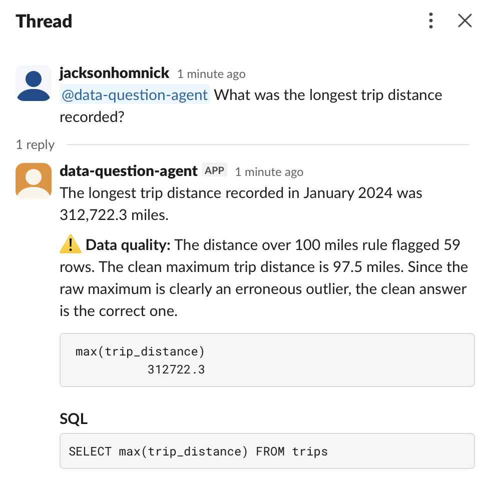

# Data Question Agent

Ask a question about data in plain English. The agent writes the SQL, runs it, checks the result, and answers with a chart. It also flags bad records and shows how they change the answer.

**Live demo: [jackson-data-question-agent.streamlit.app](https://jackson-data-question-agent.streamlit.app)**


## The problem

Most people on a team can't write SQL, so simple questions wait in an analyst's queue. Text-to-SQL tools answer those questions, but most report whatever the data says, bad records included. In this data, the longest recorded taxi trip is 312,722 miles. This agent answers the question, shows its SQL so anyone can check the work, and flags records that are almost surely errors.

## How it works

1. You type a question, like "Which borough had the most pickups?" in the web page, in Slack, or through any MCP client.
2. Retrieval finds the three most similar questions in a library of 25 examples with checked SQL, using Gemini's embedding model, and adds them to the prompt as patterns.
3. Gemini (`gemini-3.5-flash-lite`, through Google's free API tier) reads the database schema and writes a DuckDB query.
4. The `run_sql` tool runs the query read-only and returns the first rows. If the query fails, Gemini sees the error and fixes it.
5. Gemini checks the quality rules. If its query reads a flagged column, it runs the same query on the clean data too.
6. Gemini calls `show_result` with the final query, a short answer, a chart type, and any quality note. On its last allowed turn it must call `show_result`, so it can't spend every turn exploring.
7. The answer goes back with the SQL and a data-quality warning when rules apply, and the question is logged with its time, tokens, and errors.

## Data quality check

`setup_data.py` builds eight rules for records that are almost surely data-entry errors, refunds, or meter faults. Together they flag 127,122 of 2,964,606 trips (4%).

| Rule | Columns it affects | Trips flagged |
|---|---|---|
| Zero or negative distance | `trip_distance` | 60,371 |
| Negative fare | `fare_amount`, `total_amount` | 37,447 |
| Negative total | `total_amount` | 35,503 |
| Zero passengers | `passenger_count` | 31,465 |
| Trip longer than 6 hours | `pickup_at`, `dropoff_at` | 1,772 |
| Drop-off at or before pickup | `pickup_at`, `dropoff_at` | 870 |
| Distance over 100 miles | `trip_distance` | 59 |
| Fare over $500 | `fare_amount`, `total_amount` | 46 |

The rules are stored in a `quality_rules` table, and a `trips_clean` view leaves out every flagged trip. The agent answers from the raw data first and adds the clean answer only when its query reads a flagged column. Examples:

| Question | Raw answer | Clean answer |
|---|---|---|
| Longest trip distance | 312,722.3 miles | 97.5 miles |
| Average trip distance | 3.65 miles | 3.30 miles |
| Which borough had the most pickups | Manhattan | Same answer, no warning: this question only counts trips, and the rules check distance, fares, times, and passengers |

## Test score

`run_evals.py` asks 20 questions with known answers and checks each result against a reference query. Twelve of the questions also test the quality check: four should get a flag with the right clean answer, and eight should get no flag.

Final live run (November 5, 2026, `gemini-3.5-flash-lite`):
- **Answers: 20/20**
- **Quality checks: 12/12**

With retrieval (November 6, 2026), run once with examples and once with `--no-examples`:

| | Answers | Quality checks | Queries run | Failed queries | Total time |
|---|---|---|---|---|---|
| With examples | 20/20 | 12/12 | 63 | 0 | 140 s |
| Without examples | 20/20 | 12/12 | 68 | 1 | 164 s |

Retrieval didn't change the score on this test set, which the agent already answers fully. It made the agent about 15% faster, with fewer exploratory queries and no failed ones. Tokens were about the same (101,188 with examples, 103,028 without), because the examples add prompt text but save turns. A harder test set would show more; that's a next step.

How it got there:
- Run 1 scored 18/20 on answers. Both misses were Google's servers returning "busy" (HTTP 503), not wrong answers, so the agent now waits and retries.
- Run 2 scored 19/20. The one miss was the scorer: the agent answered "January 27, 2024," which is right, but the scorer only matched "2024-01-27." The scorer now reads written-out dates.
- Run 3, the first with the quality check, scored 8/12 on quality checks. All four misses were the model flagging questions that only count trips, sometimes while its own note said no rule applied. The code now double-checks the model: a flag stays only when the query names a flagged column.

## Retrieval

`examples/examples.json` holds 25 questions with SQL that was run and checked against the database. `retrieval.py` embeds them once with `gemini-embedding-001` (cached in `data/`), embeds each new question, and passes the closest three to the model when their similarity is at least 0.65. Related taxi questions score about 0.78 to 0.84; an unrelated one ("What is the capital of France?") scored 0.58, so it gets no examples. None of the examples repeats a test question, so the test score stays honest. If the embedding call fails, the agent answers without examples.

## Observability

Every question, from every front end, is logged to `logs/queries.jsonl`: time, source (web, Slack, MCP, test), model, seconds, tokens, queries run, failed queries, examples used, whether a quality flag was raised, the final SQL, and any error. `python log_summary.py` turns the log into a table by source. The log has already paid off: it showed one run spending all 8 turns on `run_sql` without an answer, which led to the forced `show_result` on the last turn.

## Use it from any MCP client

`mcp_server.py` exposes the agent over the Model Context Protocol, so Claude Desktop, Claude Code, Cursor, or any other MCP client can use it as a tool. It has three read-only tools:

| Tool | What it does |
|---|---|
| `ask_question` | The full agent: plain English in; answer, SQL, first rows, and quality note out |
| `run_sql` | One read-only query, first 50 rows back as CSV |
| `describe_database` | Tables, columns with notes, and the quality rules |

To add it to Claude Desktop, put this in its config file (Settings > Developer > Edit Config), with your own paths:

```json
{
  "mcpServers": {
    "data-question-agent": {
      "command": "/path/to/data-question-agent/.venv/bin/python",
      "args": ["/path/to/data-question-agent/mcp_server.py"]
    }
  }
}
```

## Live demo

Try it: **[jackson-data-question-agent.streamlit.app](https://jackson-data-question-agent.streamlit.app)**

The web page runs on Streamlit Community Cloud. On a fresh server it downloads the data and builds the database on first start (about a minute). Its secrets hold the Gemini key, an optional `APP_PASSWORD`, and `DAILY_QUESTION_LIMIT` (default 50), which protects the free API quota.

## Design decisions

- **Read-only by design.** The database opens read-only, and the tool accepts only one `SELECT` or `WITH` query at a time, so a bad or hostile prompt can't change the data.
- **Errors go back to the model.** A failed query returns DuckDB's error message, and the model fixes its own SQL.
- **Code checks the model.** Whether a quality rule applies is decided by checking the SQL for flagged column names, not by trusting the model's judgment alone.
- **Rules are data, not prompt text.** The rules and their counts live in a table, so the agent cites real numbers and new rules need no prompt changes.
- **Built for a free tier.** The client times out after 60 seconds, waits and retries when the server is busy or the rate limit hits, and the test script pauses between questions.

## Run it

Needs Python 3.10 or newer and a free Gemini API key from [Google AI Studio](https://aistudio.google.com).

```bash
python3 -m venv .venv
source .venv/bin/activate
pip install -r requirements.txt
read -s "KEY?Paste your Gemini API key: " && echo "GEMINI_API_KEY=$KEY" > .env && unset KEY
python setup_data.py
streamlit run app.py
```

Run the tests (about 40 to 80 API calls):

```bash
python run_evals.py
```

## Use it in Slack

`@mention` the bot with a question in any channel it's in. It replies in the thread with the answer, a data-quality warning when one applies, a preview of the result, and the SQL. It uses Slack's Socket Mode, so it connects out from your computer and needs no public server. It answers only while `slack_bot.py` is running.



Set it up once:
1. Go to [api.slack.com/apps](https://api.slack.com/apps), click **Create New App**, choose **From a manifest**, pick your workspace, and paste in `slack_manifest.yml`.
2. Under **Basic Information > App-Level Tokens**, create a token with the `connections:write` scope. It starts with `xapp-`.
3. Under **Install App**, install it to your workspace and copy the **Bot User OAuth Token**. It starts with `xoxb-`.
4. Add both tokens to `.env`:

```bash
read -s "KEY?Paste the xoxb- bot token: " && echo "SLACK_BOT_TOKEN=$KEY" >> .env && unset KEY
read -s "KEY?Paste the xapp- app token: " && echo "SLACK_APP_TOKEN=$KEY" >> .env && unset KEY
```

5. Invite the bot to a channel (`/invite @data-question-agent`), then start it:

```bash
python slack_bot.py
```

Test the Slack and MCP code without any API calls (the MCP tests need the database):

```bash
python -m unittest discover tests
```

## Files

| File | Purpose |
|---|---|
| `setup_data.py` | Downloads the data, builds `data/taxi.duckdb`, and creates the quality rules and clean view |
| `agent.py` | The agent: prompt, tools, tool-use loop, quality-flag check, and query log |
| `retrieval.py` | Finds similar example questions with embeddings |
| `examples/examples.json` | 25 example questions with checked SQL |
| `app.py` | The Streamlit page, with an optional password and a daily question cap for hosting |
| `mcp_server.py` | The MCP server: `ask_question`, `run_sql`, and `describe_database` |
| `log_summary.py` | Summarizes `logs/queries.jsonl` by source |
| `evals/questions.json` | 20 test questions with reference SQL and expected quality flags |
| `run_evals.py` | Scores answers and quality checks, and saves results to `evals/results/`; `--no-examples` turns retrieval off |
| `tests/test_mcp_server.py` | Starts the MCP server like a real client and checks its tools (no API calls) |
| `slack_bot.py` | The Slack front end: listens for @mentions and replies in the thread |
| `slack_manifest.yml` | Slack app settings to paste in when creating the app |
| `tests/test_slack_bot.py` | Tests for the Slack reply logic, using fake Slack and Gemini clients |

## Data

NYC Taxi and Limousine Commission yellow taxi trips for January 2024, plus the taxi zone lookup. Source: [TLC Trip Record Data](https://www.nyc.gov/site/tlc/about/tlc-trip-record-data.page).

| Table | What it holds |
|---|---|
| `trips` | One row per trip: times, distance, pickup and drop-off zone, payment type, fare, tip, total |
| `trips_clean` | `trips` without the flagged records |
| `zones` | Zone ID to borough and zone name |
| `payment_types` | Payment code to name |
| `quality_rules` | Each quality rule, the columns it affects, and how many trips it flags |

## Limits

- Google's free tier uses what you send to improve its products, so the agent runs on public data only.
- One question at a time; it doesn't remember earlier questions.
- The tests check that the right value appears in the result, not that the SQL is the best possible query.
- The quality rules are fixed thresholds I chose (for example, 100 miles and 6 hours). A real team would tune them with the people who own the data.

## License

MIT. See [LICENSE](LICENSE).
