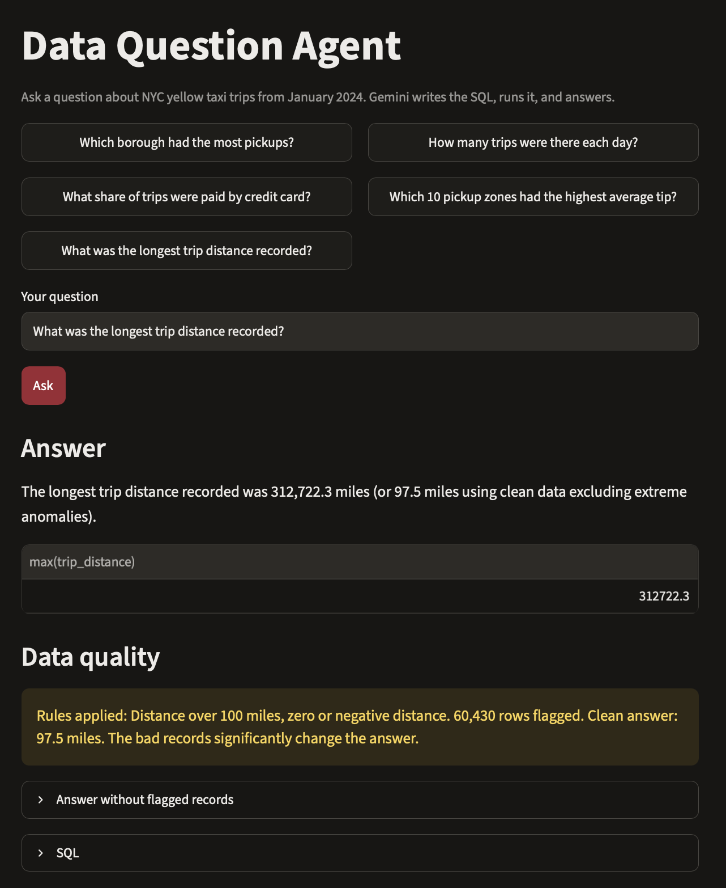

# Data Question Agent

Ask a question about data in plain English. The agent writes the SQL, runs it, checks the result, and answers with a chart. It also flags bad records and shows how they change the answer.



## The problem

Most people on a team can't write SQL, so simple questions wait in an analyst's queue. Text-to-SQL tools answer those questions, but most report whatever the data says, bad records included. In this data, the longest recorded taxi trip is 312,722 miles. This agent answers the question, shows its SQL so anyone can check the work, and flags records that are almost surely errors.

## How it works

1. You type a question, like "Which borough had the most pickups?"
2. Gemini (`gemini-3.5-flash-lite`, through Google's free API tier) reads the database schema and writes a DuckDB query.
3. The `run_sql` tool runs the query read-only and returns the first rows. If the query fails, Gemini sees the error and fixes it.
4. Gemini checks the quality rules. If its query reads a flagged column, it runs the same query on the clean data too.
5. Gemini calls `show_result` with the final query, a short answer, a chart type, and any quality note.
6. The page shows the answer, the chart, the table, the SQL, and a Data quality box when rules apply.

## Data quality check

`setup_data.py` builds eight rules for records that are almost surely data-entry errors, refunds, or meter faults. Together they flag 127,122 of 2,964,606 trips (4%).

| Rule | Columns it affects | Trips flagged |
|---|---|---|
| Zero or negative distance | `trip_distance` | 60,371 |
| Negative fare | `fare_amount`, `total_amount` | 37,447 |
| Negative total | `total_amount` | 35,503 |
| Zero passengers | `passenger_count` | 31,465 |
| Trip longer than 6 hours | `pickup_at`, `dropoff_at` | 1,772 |
| Drop-off at or before pickup | `pickup_at`, `dropoff_at` | 870 |
| Distance over 100 miles | `trip_distance` | 59 |
| Fare over $500 | `fare_amount`, `total_amount` | 46 |

The rules are stored in a `quality_rules` table, and a `trips_clean` view leaves out every flagged trip. The agent answers from the raw data first and adds the clean answer only when its query reads a flagged column. Examples:

| Question | Raw answer | Clean answer |
|---|---|---|
| Longest trip distance | 312,722.3 miles | 97.5 miles |
| Average trip distance | 3.65 miles | 3.30 miles |
| Which borough had the most pickups | Manhattan | No flag: counting trips reads no flagged column |

## Test score

`run_evals.py` asks 20 questions with known answers and checks each result against a reference query. Twelve of the questions also test the quality check: four should get a flag with the right clean answer, and eight should get no flag.

Final live run (November 5, 2026, `gemini-3.5-flash-lite`):
- **Answers: 20/20**
- **Quality checks: 12/12**

How it got there:
- Run 1 scored 18/20 on answers. Both misses were Google's servers returning "busy" (HTTP 503), not wrong answers, so the agent now waits and retries.
- Run 2 scored 19/20. The one miss was the scorer: the agent answered "January 27, 2024," which is right, but the scorer only matched "2024-01-27." The scorer now reads written-out dates.
- Run 3, the first with the quality check, scored 8/12 on quality checks. All four misses were the model flagging questions that only count trips, sometimes while its own note said no rule applied. The code now double-checks the model: a flag stays only when the query names a flagged column.

## Design decisions

- **Read-only by design.** The database opens read-only, and the tool accepts only one `SELECT` or `WITH` query at a time, so a bad or hostile prompt can't change the data.
- **Errors go back to the model.** A failed query returns DuckDB's error message, and the model fixes its own SQL.
- **Code checks the model.** Whether a quality rule applies is decided by checking the SQL for flagged column names, not by trusting the model's judgment alone.
- **Rules are data, not prompt text.** The rules and their counts live in a table, so the agent cites real numbers and new rules need no prompt changes.
- **Built for a free tier.** The client times out after 60 seconds, waits and retries when the server is busy or the rate limit hits, and the test script pauses between questions.

## Run it

Needs Python 3.10 or newer and a free Gemini API key from [Google AI Studio](https://aistudio.google.com).

```bash
python3 -m venv .venv
source .venv/bin/activate
pip install -r requirements.txt
read -s "KEY?Paste your Gemini API key: " && echo "GEMINI_API_KEY=$KEY" > .env && unset KEY
python setup_data.py
streamlit run app.py
```

Run the tests (about 40 to 80 API calls):

```bash
python run_evals.py
```

## Files

| File | Purpose |
|---|---|
| `setup_data.py` | Downloads the data, builds `data/taxi.duckdb`, and creates the quality rules and clean view |
| `agent.py` | The agent: prompt, tools, tool-use loop, and the quality-flag check |
| `app.py` | The Streamlit page |
| `evals/questions.json` | 20 test questions with reference SQL and expected quality flags |
| `run_evals.py` | Scores answers and quality checks, and saves results to `evals/results/` |

## Data

NYC Taxi and Limousine Commission yellow taxi trips for January 2024, plus the taxi zone lookup. Source: [TLC Trip Record Data](https://www.nyc.gov/site/tlc/about/tlc-trip-record-data.page).

| Table | What it holds |
|---|---|
| `trips` | One row per trip: times, distance, pickup and drop-off zone, payment type, fare, tip, total |
| `trips_clean` | `trips` without the flagged records |
| `zones` | Zone ID to borough and zone name |
| `payment_types` | Payment code to name |
| `quality_rules` | Each quality rule, the columns it affects, and how many trips it flags |

## Limits

- Google's free tier uses what you send to improve its products, so the agent runs on public data only.
- One question at a time; it doesn't remember earlier questions.
- The tests check that the right value appears in the result, not that the SQL is the best possible query.
- The quality rules are fixed thresholds I chose (for example, 100 miles and 6 hours). A real team would tune them with the people who own the data.

## License

MIT. See [LICENSE](LICENSE).
